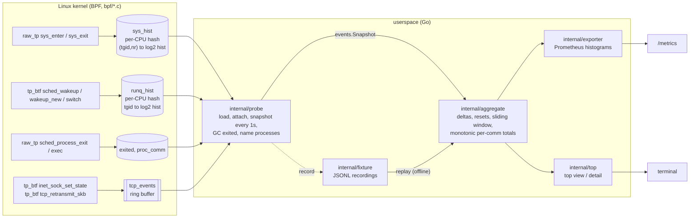

# sysprobe

An eBPF profiler for Linux that answers "which process is waiting on the
kernel, for what, and for how long?" It records:

- **per-process syscall latency histograms** (enter to exit, per syscall),
- **run-queue latency** per process (runnable to running),
- **TCP connect latency and retransmit events** (per destination),

aggregates them in the kernel where possible, and exposes the result as
**Prometheus histograms** and a **top-style terminal view**. Everything
downstream of the kernel also runs offline against recorded fixtures, so the
aggregation, exporter and UI are fully tested on a laptop with no eBPF at
all.

Go ([cilium/ebpf](https://github.com/cilium/ebpf) v0.22) for userspace, C for
the BPF programs, compiled with clang 19 in a pinned Linux builder image
(macOS clang has no BPF backend).

**Who it is for:** engineers who want something between `strace -c` (too
slow to leave on) and a full continuous-profiling stack: a single static
binary that shows syscall and scheduler latency per process and can be
scraped by Prometheus.

## Status, in one paragraph

Built and verified end to end on one real kernel: Linux 7.0.14-linuxkit
(aarch64), inside a privileged container on Docker Desktop for macOS. The
committed transcript `integration/results/7.0.14-linuxkit.txt` is that run.
The CI workflow adds a second kernel (the GitHub `ubuntu-latest` runner, with
`sudo`) but **has never executed**: this repository has not been pushed. No
production use is claimed.

## Architecture



Data flows one way: the kernel keeps **cumulative** histograms; once per
interval the probe reads every map into an `events.Snapshot` (cumulative
histograms + new TCP events + kernel drop counters). The aggregator differences
consecutive readings and feeds three consumers: a per-process sliding window
(the top view), per-process lifetime totals, and per-comm totals that never
decrease (the exporter). A recorded fixture is just a stream of those
snapshots, which is why replay exercises exactly the same code as live use.
Design details, algorithms and complexity: [docs/ARCHITECTURE.md](docs/ARCHITECTURE.md).

## Quickstart

Offline, on any OS with Go 1.27:

```sh
make check      # gofmt, go vet (host + GOOS=linux), golangci-lint (host + linux), tests -race, coverage gate
make demo       # replay the fixtures recorded on a real kernel
```

Live, on Linux as root (kernel requirements: [docs/KERNEL.md](docs/KERNEL.md)):

```sh
go build -o sysprobe ./cmd/sysprobe
sudo ./sysprobe doctor                 # which collectors this kernel supports
sudo ./sysprobe top                    # interactive: s=sort  e=exited  p=pause  q=quit
sudo ./sysprobe run -listen :9464      # Prometheus on /metrics, /healthz
sudo ./sysprobe record -o cap.jsonl -duration 30s
./sysprobe replay -pid 1234 -metrics cap.jsonl   # anywhere, no privileges
```

From macOS with Docker (what produced the committed recordings):

```sh
make integration   # builder image, privileged --pid=host container, records fixtures + transcript
make bpf           # recompile bpf/*.c into internal/probe/*_bpfel.o (committed)
```

`make integration` prints `SKIP integration: Docker is not available` and
exits 0 when there is no Docker daemon.

## Demo output (real run)

`make demo` replays two recordings made by `make integration`. Part 2 is the
known workload from the integration test: `sysprobe-loadgen` with 2 threads
calling `clock_nanosleep(3ms)` and one thread doing 1-byte reads of
`/dev/zero`. Excerpt of the output (full run: 149 lines):

```text
== 2. the known workload: loadgen pid 43666 slept 3ms per clock_nanosleep ==
replaying recorded fixture: kernel 7.0.14-linuxkit, arch aarch64, interval 500ms, recorded by "integration.TestLiveKernel"

process 43666 sysprobe-loadge (exited)  window 4.65s
  SYSCALL              WIN-CALLS   IN-SYS   WIN-P50   WIN-P99 |      CALLS      MEAN       P50       P99
  futex                        0        -         -         - |      12153   851.9us    62.8us     1.1ms
  clock_nanosleep              0        -         -         - |       1686     3.6ms     3.3ms     8.2ms
  nanosleep                    0        -         -         - |      21638   136.8us   103.2us   461.8us
  read                         0        -         -         - |    6164606     150ns     116ns     254ns
  ...
  clock_nanosleep latency (lifetime, 1686 calls)
        16us .. 33us     |#                                       | 3
        66us .. 131us    |#                                       | 1
         2ms .. 4ms      |########################################| 1499
         4ms .. 8ms      |####                                    | 175
         8ms .. 17ms     |#                                       | 8

# ---- Prometheus exposition (filter "sysprobe-loadge,clock_nanosleep") ----
sysprobe_syscall_latency_seconds_bucket{comm="sysprobe-loadge",syscall="clock_nanosleep",le="0.001048576"} 4
sysprobe_syscall_latency_seconds_bucket{comm="sysprobe-loadge",syscall="clock_nanosleep",le="0.004194304"} 1503
sysprobe_syscall_latency_seconds_bucket{comm="sysprobe-loadge",syscall="clock_nanosleep",le="0.016777216"} 1686
sysprobe_syscall_latency_seconds_sum{comm="sysprobe-loadge",syscall="clock_nanosleep"} 5.99737233
sysprobe_syscall_latency_seconds_count{comm="sysprobe-loadge",syscall="clock_nanosleep"} 1686
```

The loadgen itself reported 1686 sleeps and 6,164,602 reads; the kernel
counted 1686 `clock_nanosleep` and 6,164,606 `read` calls (four reads more
than the loop's own count, made by the same process outside the measured
loop; the verifier accepts `>=` for reads and an exact range for sleeps). The `nanosleep` and `futex` rows are the Go runtime
(`runtime.usleep`, parking), which is exactly why the workload uses
`clock_nanosleep`: the first version used `nanosleep`, and the integration
test caught the runtime's calls mixed into the count. The four sub-millisecond
`clock_nanosleep` samples are sleeps interrupted by Go's preemption signal
(EINTR).

Part 1 of the demo is the end-of-recording top view of the whole Docker VM
(dockerd, containerd and the other containers that were running):

```text
sysprobe top  snapshot 9  elapsed 8.016s  window 8.016s  arch aarch64  sort busy
processes 63  tcp connects 14  failed 3  retransmits 11  series resets 0  evicted 0
kernel drops  syscalls/missed_start=96

    PID COMM              SYSC/s  IN-SYS      P50      P99  TOP SYSCALL (IN-SYS)         RUNQ/s   RQ-P99  CONN
    267 dockerd           1698.9  716.5%    3.1us    6.8ms  futex (617.8%)                496.5  491.2us     -
    131 initd              579.9  684.7%    2.2us  168.4ms  futex (537.1%)                120.6    2.2ms     -
    247 containerd        1875.9  492.0%    1.9us    2.9ms  futex (392.9%)                460.1  410.2us     -
  ...
TCP DESTINATION                            CONN   FAIL   RETX      P50      P99
127.0.0.1:41933                              10      0      0   10.2us  124.5us
127.0.0.1:49965                               1      2      6   65.5us   65.5us
127.0.0.1:34569                               0      1      0        -        -
```

`IN-SYS` is summed syscall time per second of wall time: 100% means on
average one thread was inside a syscall the whole window, so a process with
many threads blocked in `futex` shows several hundred percent. The three TCP
destinations are the loadgen's scenarios: 10 accepted connects, a listener
whose accept queue overflowed (1 connect, 2 time-outs, 6 SYN retransmits),
and a closed port (1 refused connect, which loses its source port before the
event fires, shown as `127.0.0.1:*` in the event list).

## Results and benchmarks (every number has its command)

| What | Result | Command / source |
|---|---|---|
| Integration test on a real kernel | PASS: kernel counts match the workload's own counts (see above), loopback connects 20/20, refused 1/1, SYN retransmits observed | `make integration` → `integration/results/7.0.14-linuxkit.txt` |
| Same assertions, offline, on the committed recording | PASS, plus 8 mutated expectations that must each be rejected | `go test ./integration/` |
| Probe overhead per syscall, syscalls collector | +191.4 ns (158.99 → 350.38 ns per `getppid()`, median of 7×2M calls) | `make integration`, last lines of the transcript |
| Probe overhead per syscall, all collectors | +193.1 ns (158.99 → 352.07 ns) | same |
| Core-logic test coverage | 97.5% of statements across the 12 core packages | `make cover` |
| Aggregator ingest | 372 µs per snapshot of 2,000 series (≈186 ns/series), 5 allocs | `make bench` (`BenchmarkIngest`, macOS arm64 dev machine) |
| Top view build | 0.96 ms for 100 processes × 20 syscalls × 10-snapshot window | `make bench` (`BenchmarkView`) |
| Quantile from a log2 histogram | 36 ns, 0 allocs | `make bench` (`BenchmarkQuantile`) |

The overhead numbers come from a virtualised arm64 VM where a bare
`getppid()` costs 159 ns; on bare metal both the baseline and the added cost
will differ. They measure the worst case for this design (the cheapest
possible syscall, so the probe's fixed cost dominates). More in
[docs/KERNEL.md](docs/KERNEL.md#overhead).

## Design decisions (short version; full list in [DECISIONS.md](DECISIONS.md))

- **Histograms in the kernel, events through a ring buffer.** Syscalls and
  context switches happen millions of times per second, so they are folded
  into per-CPU log2 histograms in the kernel and read once per interval.
  TCP connects and retransmits are rare, so they are streamed individually.
- **Raw and BTF tracepoints only.** The syscall collector uses raw
  tracepoints and needs neither tracefs nor kernel BTF (kernel >= 4.17). The
  scheduler and TCP collectors use `tp_btf` with CO-RE field access, because
  the classic `tcp_retransmit_skb` record layout changed in 6.x (it gained an
  `err` field) while the BTF arguments did not. Instead of a 3 MB generated
  `vmlinux.h`, `bpf/core_types.h` declares only the handful of `task_struct`
  and `sock` fields that are read.
- **Exact Prometheus buckets.** Exported `le` bounds are powers of two
  nanoseconds, the same edges as the kernel's buckets, so the exporter adds no
  re-bucketing error.
- **Monotonic, bounded labels.** By default series are labelled by `comm`.
  Per-comm totals survive process exit, and label admission is first-come and
  sticky ("other" after 256 comms, 64 TCP destinations), so counters never go
  backwards and cardinality is bounded. `-prom-labels pid` is available.
- **Exit and exec from the kernel, not /proc.** Exited processes are
  garbage-collected from `sched_process_exit`, and processes are named after
  their group leader (`proc_comm`), so it works in any PID namespace.

## Repository map

| Path | What |
|---|---|
| `bpf/` | BPF C: `syscalls.bpf.c`, `runq.bpf.c`, `tcp.bpf.c`, shared `sysprobe.h`, minimal CO-RE `core_types.h` |
| `internal/probe` | load/attach (cilium/ebpf), map snapshots, exit GC, process naming; generated `*_bpfel.go/.o` |
| `internal/events` | snapshot types, byte-exact decoders for the kernel structs, process naming |
| `internal/hist` | log2 histogram: delta and reset detection, quantiles, Prometheus bucket counts |
| `internal/aggregate` | delta/reset handling, sliding windows, eviction, per-comm totals, TCP aggregation |
| `internal/exporter` | Prometheus collector |
| `internal/top` | top view, per-process detail, ASCII histograms |
| `internal/fixture`, `internal/source` | JSONL recordings, replay source, tee recorder |
| `internal/kernel` | kernel requirement checks (`sysprobe doctor`) |
| `internal/app`, `cmd/sysprobe` | pipelines and CLI |
| `cmd/sysprobe-loadgen` | benign loopback workload for tests, demo and overhead benchmark |
| `integration/` | privileged end-to-end test, workload ground truth, offline verifier, transcripts |
| `testdata/` | recorded fixtures (real kernel), raw kernel bytes, one synthetic fixture |

## Limitations

- **One kernel verified.** Only Linux 7.0.14-linuxkit/aarch64 (a VM) has
  actually run the BPF programs. x86_64 is supported by design (same `bpfel`
  objects, x86_64 syscall table, CO-RE) but has not been executed; the CI job
  that would do it has not run because nothing has been pushed.
- **Overhead measured in a VM, on one syscall type.** +191 ns per syscall
  is real but specific to that VM and to `getppid()`. Syscall-heavy
  workloads (millions of syscalls per second per core) will feel it.
- **Blocking syscalls dominate IN-SYS.** `futex`, `epoll_wait` and friends
  are counted like any other syscall; there is no off-CPU/on-CPU split.
- **Process names are best effort.** The authoritative name comes from exec
  or from the group leader's own syscalls; a process whose leader never makes
  a syscall while sysprobe runs is named after its most common thread name.
  Deltas recorded before an exec stay attributed to the old name.
- **Threads outliving their leader.** GC runs when the group leader exits; a
  thread that keeps running afterwards re-creates keys, which then show up as
  a new process with the same pid.
- **Lost samples are counted, not avoided.** A new histogram key can fail to
  insert when the per-CPU allocator is empty under bursts of new processes
  (`sysprobe_bpf_drops_total{reason="hist_insert_failed"}`); the first
  syscalls after attach have no start timestamp (`missed_start`).
- **Retransmits have no pid.** They fire from the timer softirq; they are
  attributed to the flow (destination), not to a process.
- **Failed connects lose their source port** on the kernels tested (shown as
  `:*`).
- **IPv6** decoding is implemented and unit-tested, but every recorded TCP
  event is IPv4 loopback.
- **No container/cgroup labels**, no stack traces, no per-thread view.
- **The recordings include other containers' processes** that happened to run
  on the Docker VM (dockerd, a postgres and nginx container, health checks):
  names and pids only; see [DATA.md](DATA.md).

## Roadmap

1. Run the CI integration job on an x86_64 runner kernel and commit that
   transcript next to the linuxkit one.
2. Task-local storage (`BPF_MAP_TYPE_TASK_STORAGE`) for syscall start
   timestamps on BTF kernels, to cut the per-syscall cost below the LRU hash
   lookup.
3. cgroup id per process, to label by container.
4. Separate blocking syscalls (futex, poll family) into their own view.

## License

MIT, see [LICENSE](LICENSE). The BPF programs declare `Dual MIT/GPL` because
the kernel requires a GPL-compatible license for the helpers they use.
